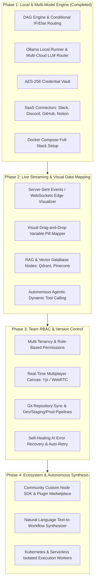

# ⚡ Nexus Flow - Next-Gen AI Workflow Automation Engine (n8n Alternative)

An industry-grade, responsive, self-hosted **AI Workflow Automation Platform** designed for real-time DAG execution, conditional branching (IF/Else handles), local model execution via **Ollama**, universal multi-cloud LLM routing (**OpenAI, Claude, DeepSeek, Gemini, Qwen, MiniMax, Groq**), and native SaaS app integrations (**Slack, Discord, GitHub, Notion, Google Calendar**).

---

## 🚀 Key Features

### 🎨 1. Modern n8n-Style Workflow Canvas
- **DAG Topological Execution**: True dependency graph execution with conditional branch pruning (routes payloads down `True` vs `False` paths without running untriggered branches).
- **Multi-Handle Conditional Logic**: True/False handles with Emerald and Rose indicators.
- **Node-Level Hover Actions**: 1-Click single-node step testing (Play), duplicate node, and delete.
- **3-Tab Configuration Drawer**:
  - **Parameters**: Dynamic schema forms, prompt editors, temperature sliders, model selectors.
  - **Test Step**: Live execution of individual nodes with custom input JSON payloads and instant feedback.
  - **Output Schema**: Live JSON preview with one-click clipboard copying.
- **Auto Layout & Export/Import**: Download workflow JSON blueprints or import existing topologies with 1 click.

### 🧠 2. Universal Multi-Model & Local Ollama Support
- **Local Self-Hosted LLMs (Ollama)**:
  - Connect to local Ollama on `http://localhost:11434` or Docker service `http://ollama:11434`.
  - Zero cloud dependency, 100% private execution for `deepseek-r1`, `llama3.3`, `qwen2.5`, `mistral`, `phi4`.
  - Built-in connection tester and model auto-discovery (`/api/credentials/ollama-ping`).
- **Cloud Frontier Models**:
  - **Google Gemini**: Gemini 2.5 Flash, Gemini 3.1 Pro Preview, and Google Search Grounding with web citations.
  - **OpenAI**: GPT-4o, GPT-4o-mini, o3-mini.
  - **Anthropic**: Claude 3.7 Sonnet, Claude 3.5 Haiku.
  - **DeepSeek API**: DeepSeek-V3 and DeepSeek-R1 cloud endpoints.
  - **Alibaba Qwen**: Qwen 2.5 Max, Qwen-Plus, Qwen-Coder.
  - **MiniMax**: MiniMax-01 and MiniMax-Chat.
  - **Groq**: Ultra low-latency LPU inference for Llama 3.3 70B.

### 🔌 3. SaaS Connectors & App Integrations
- **Slack**: Send rich formatted blocks, alerts, and notifications to incoming webhooks.
- **Discord**: Broadcast embed notifications to server channels.
- **GitHub**: Automate issue creation, fetch pull requests, and trigger repository dispatches.
- **Notion**: Query and create pages directly inside Notion databases.
- **Google Calendar**: Full event creation, search, attendees management, and conflict resolution.
- **Webhooks & Cron**: Inbound HTTP triggers (`/api/webhooks/:webhookId`) and scheduled time triggers.

### 🔒 4. Encrypted Credential Vault
- Built-in **AES-256 encrypted vault** for safely storing API keys and webhook tokens locally or in database.
- Dedicated **Vault & Keys** manager UI with provider presets and connectivity tests.

---

## 🛠️ Quick Start & Local Setup

### Prerequisites
- Node.js 18+ (Node 20 recommended)
- npm or yarn

### 1. Install Dependencies
```bash
npm install
```

### 2. Environment Configuration
Create a `.env` file in the root directory (optional, sensible defaults and offline fallbacks are built-in):
```env
PORT=3000
GEMINI_API_KEY=your_gemini_api_key_here
OPENAI_API_KEY=your_openai_api_key_here
ANTHROPIC_API_KEY=your_anthropic_api_key_here
DEEPSEEK_API_KEY=your_deepseek_api_key_here
VAULT_SECRET=your_32_character_encryption_secret_key!
```

### 3. Start Development Server
```bash
npm run dev
```
Open **`http://localhost:3000`** in your browser.

---

## 🐳 Docker & Self-Hosted Stack

Run the full production stack including PostgreSQL, Redis, Ollama, and the Nexus Flow application:

```bash
cp .env.example .env   # optional: set API keys & model list
docker-compose up -d
```

### What the stack does automatically
- **Ollama healthchecks** gate startup — the app only starts once Ollama is live.
- **`ollama-init` service** pulls every model listed in `OLLAMA_MODELS` (from `.env`) on first boot, so local models are **available offline** afterwards (persisted in the `ollama_models` volume). Models already pulled are skipped.
- **App healthcheck** on `/api/health` for orchestrators and `docker compose ps` visibility.
- **GPU support (NVIDIA)**: uncomment the `deploy.resources` block on the `ollama` service (requires `nvidia-container-toolkit` on the host). Without it, Ollama runs on CPU.

### Choosing models (online → offline)
```bash
# 1. Set the models you want pre-pulled in .env:
#    OLLAMA_MODELS=deepseek-r1:7b,llama3.1:8b,qwen2.5:7b
# 2. Or pull manually at any time:
docker exec -it nexus-flow-ollama ollama pull llama3.3
# 3. List what's available:
docker exec -it nexus-flow-ollama ollama list
```
Once pulled, models run fully offline — no internet required for inference.

### Using online cloud models
Add any of these to `.env` and the Universal AI Model node routes to them for real (no more simulated responses):
```env
OPENAI_API_KEY=sk-...          # gpt-4o, gpt-4o-mini
ANTHROPIC_API_KEY=sk-ant-...   # claude-3-7-sonnet-latest
DEEPSEEK_API_KEY=sk-...        # deepseek-chat, deepseek-reasoner
GROQ_API_KEY=gsk_...           # llama-3.3-70b-versatile
QWEN_API_KEY=sk-...            # qwen-max (DashScope compatible-mode)
MINIMAX_API_KEY=...            # MiniMax-Text-01
GEMINI_API_KEY=...             # gemini-2.5-flash / pro
```
`GET /api/models` returns the live catalog: local Ollama models + which cloud providers have keys configured. The node config drawer uses this to show clickable model chips.

### Tips
- Point `OPENAI_BASE_URL` at OpenRouter / LM Studio / vLLM / Azure gateway to use any OpenAI-compatible endpoint.
- `OLLAMA_KEEP_ALIVE=-1` keeps models loaded in RAM for instant responses; set `5m` to unload after idle.
- From the app container, Ollama is reachable at `http://ollama:11434` (already set via `OLLAMA_HOST`).

Services exposed:
- **Nexus Flow App**: `http://localhost:3000`
- **Ollama Engine**: `http://localhost:11434`
- **PostgreSQL**: `localhost:5432`
- **Redis Cache**: `localhost:6379`

---

## 🧩 Variable Templating Reference

Any node parameter can dynamically reference upstream outputs using bracket expressions:
- `{{ $json.fieldName }}`: References a specific field in the parent node output.
- `{{ input.summary }}`: References input payload.
- `{{ prev.data.id }}`: Nested object property resolution.

---

## 🛣️ Phased Roadmap & Future Scope



---

## 📄 License
MIT License. Built for developers building high-performance AI automations.
